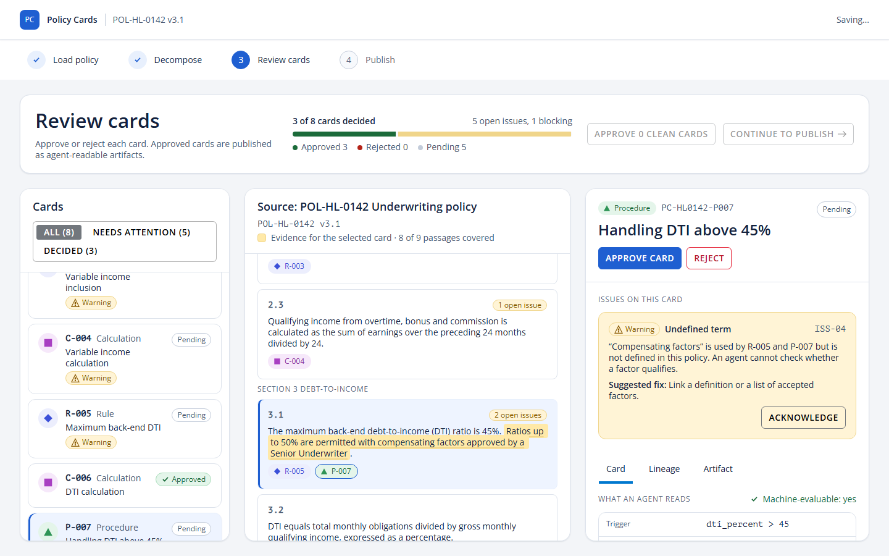

# decomp — Policy Cards

Turn long procedural policy documents into a **cohesive, reviewable set of agent-ready policy cards**, each traceable to the exact passage it came from.



## The idea

Agents need policy knowledge as explicit conditions, named inputs, formulas and steps, not as pages of prose. Chunking a document and asking a model for cards loses the structure that carries the meaning, repeats numbers until they drift, and leaves reviewers proofreading hundreds of unrelated cards.

Policy Cards decomposes a document in passes, with people reviewing where it is cheapest:

| Pass | What happens |
|---|---|
| 0 Structure | Deterministic split into passages with clause references and a parent tree, so list items inherit the obligation of their lead-in |
| 1 Map | A plan for the whole document: card slots, one registry for every number, an input vocabulary, glossary and coverage. **Reviewed before any card is written** |
| 2 Cards | One card per slot (Fact, Rule, Calculation, Procedure), verbatim evidence, executable logic and tests |
| 3 Consolidate | Deduplicate and link across sections (planned) |
| 4 Validate | Deterministic checks: coverage, numbers grounded in the source, verbatim quotes, vocabulary, passing tests |

Approved cards are published as immutable JSON artifacts with a stable ID, URI, metadata and a content hash.

- Full specification: [docs/SPEC.md](docs/SPEC.md)
- Presentation: [docs/presentation.html](docs/presentation.html) (open in a browser; arrow keys to move)
- Method notes: [docs/approach.md](docs/approach.md)

## What is in the repo

| Part | Path | What it is |
|---|---|---|
| Review UI | `src/` | Vite + React 19 + TypeScript app built on the Salt design system: Load, Decompose, Review and Publish screens |
| Method | `golden/sample-hl0142/`, `pipeline/validate.mjs` | Reference passages, policy map and cards for a fictional sample policy, and the validator |
| Tests | `src/**/*.test.ts(x)`, `e2e/` | Vitest unit and component tests; Playwright end-to-end, accessibility and visual tests |
| Tracking | `SPEC-COMPLIANCE.md`, `docs/deviations.md` | Requirement-by-requirement status, and every deliberate difference from the input specs |

The UI runs on deterministic mock adapters for ingest, decomposition and publish. A real decomposition service plugs in behind `DecompositionAdapter` (`src/adapters/types.ts`).

## Quick start

Requires Node 22 or later.

```bash
npm install
npm run dev
```

Open http://localhost:5173. Drop any `.pdf`, `.docx` or `.md` file to load the sample policy, then decompose, review and publish.

Shortcuts for exploring:

| URL | Opens |
|---|---|
| `/?demo=loaded` | Document loaded, ready to decompose |
| `/review?demo=review` | A completed run with three cards approved |
| `/__salt-check` | Design-system smoke test (dev only) |

Mock failure paths: a file named `fail.pdf` fails to load; a policy ID containing `FAIL` fails the decomposition.

## Commands

| Command | Does |
|---|---|
| `npm run dev` | Dev server on port 5173 |
| `npm run build` / `npm run preview` | Production build and local preview |
| `npm run typecheck` | Strict TypeScript |
| `npm run lint` | ESLint (typescript-eslint, react-hooks, jsx-a11y, copy-catalog rule) |
| `npm run verify:tokens` | Design-token and CSS rules |
| `npm run test` | Unit and component tests (Vitest) |
| `npm run e2e` | End-to-end, accessibility and visual tests (Playwright, dev and production builds) |
| `npm run verify` | All of the above |
| `npm run validate:cards -- sample-hl0142` | Validate the reference policy map and cards |

First Playwright run: `npx playwright install chromium`.

## Card types

| Type | Shape | An agent... |
|---|---|---|
| Fact | circle | asserts or looks up |
| Rule | diamond | evaluates a condition and gets a decision |
| Calculation | square | computes a value from named inputs |
| Procedure | triangle | executes ordered steps to a done-state |

## Status

The review UI is complete against its build spec (phases 0 to 7) and passes `npm run verify`: type check, lint, token check, 52 unit tests and 78 end-to-end tests. The decomposition method is specified, piloted on a real public guide section, and demonstrated here on a fictional sample. Next steps are in [docs/SPEC.md](docs/SPEC.md#12-roadmap): a real decomposition service, a map review step, and stable IDs across policy versions.

## Source material

No third-party source text is stored in this repository. The sample policy (POL-HL-0142) is fictional.
